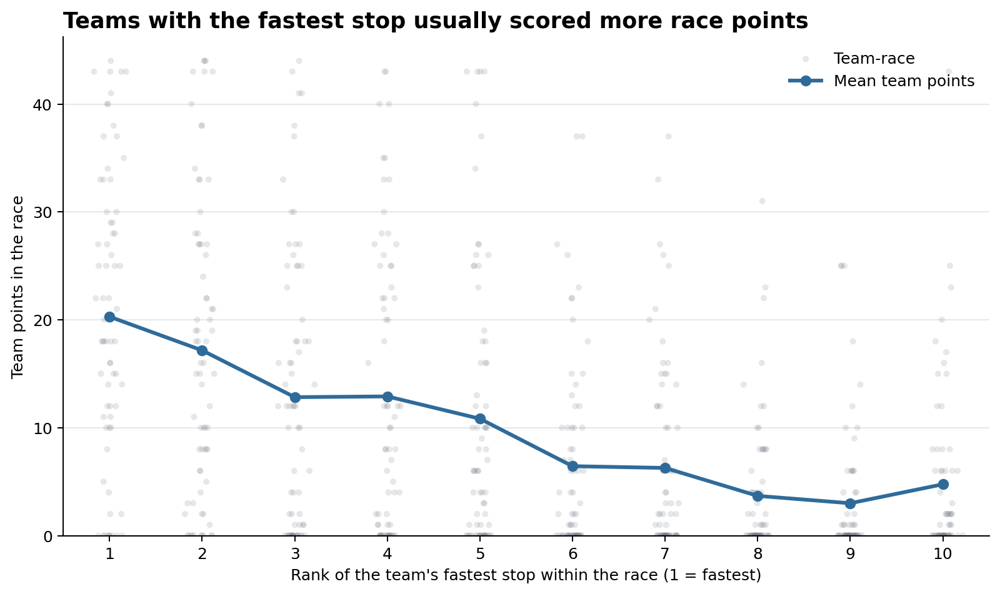
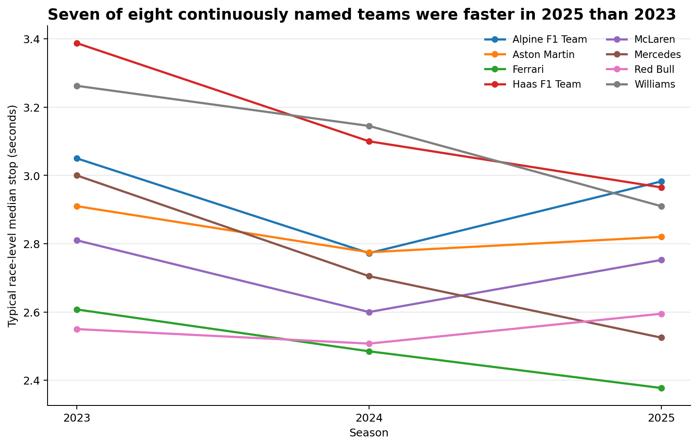
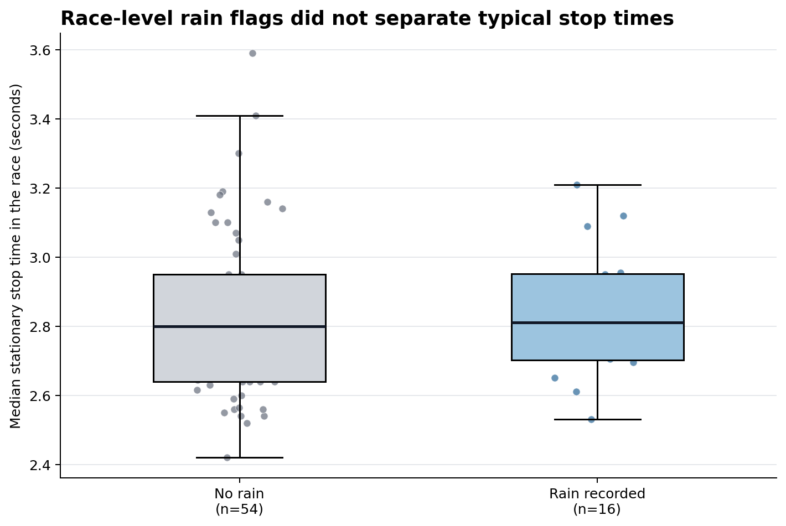

# cs418-formula-one

CS418 Intro to Data Science Project on F1

## Main Findings (Narrative Analysis)

- The team with the fastest recorded stop in a race averaged 20.3 points, compared with 8.8 points for the other teams, although the adjusted relationship was not stable after unusually slow stops were removed.
- The median recorded stop fell from 2.95 seconds in 2023 to 2.70 seconds in 2025, and seven of the eight continuously named teams improved over that period.
- Races with any recorded rain had almost the same median stop time as races without rain, 2.81 versus 2.80 seconds, so this dataset does not show a clear race-level rain difference.

### Faster stops and race points

For each of 692 team-races, we took the team's fastest DHL stop and added the Kaggle race points earned by its drivers. The team with the fastest stop averaged 20.3 points, while the remaining teams averaged 8.8, a difference of 11.5 points (95% event-cluster bootstrap interval: 8.1 to 14.9). A regression controlling for average starting position, race, and team estimated 1.51 fewer points for each additional second in the team's fastest stop (95% CI: 0.82 to 2.20 fewer points). This is an association, not evidence that the stop caused the result: the strongest teams may have both faster cars and stronger pit crews. The controls address part of that explanation, but a sensitivity check using only team-races with a best stop of four seconds or less gave an uncertain estimate of 1.99 fewer points (95% CI: 4.60 fewer to 0.63 more; p = 0.137). The apparent relationship is therefore partly influenced by unusually slow stops.

### Most teams improved from 2023 to 2025

We first found each race's median DHL stop and then compared seasons so that races with more stops did not receive extra weight. The typical race median declined by 0.25 seconds, from 2.95 seconds in 2023 to 2.70 in 2025 (95% bootstrap CI for the change: 0.15 to 0.45 seconds faster). Seven of the eight team names present in all three seasons also had a lower typical time in 2025; Mercedes had the largest change at 0.48 seconds faster. A different calendar could create part of this pattern, so we repeated the comparison on the 22 circuits shared by 2023 and 2025. The paired median change was 0.33 seconds faster (95% CI: 0.21 to 0.40), and Mercedes was 0.44 seconds faster on those shared circuits (95% CI: 0.30 to 0.70). This check supports a real time trend, but it does not identify whether crew changes, equipment, rules, or data collection produced it.

### Rain did not produce a clear race-level gap

The median stop was 2.81 seconds in the 16 races where OpenF1 recorded rain at some point and 2.80 seconds in the 54 races without recorded rain. A Mann–Whitney comparison gave p = 0.680, and a year-adjusted regression estimated a difference of only 0.008 seconds slower in rain-marked races (95% CI: 0.089 seconds faster to 0.104 seconds slower; p = 0.876). Circuit is a possible confounder, so we also compared the 11 circuits observed in both conditions; their mean within-circuit rain difference was 0.12 seconds slower, but its bootstrap interval still included no difference (95% CI: 0.03 seconds faster to 0.29 seconds slower). The largest limitation is measurement: `openf1_any_rain` means rain appeared sometime during the race, not necessarily during a specific stop, so this is an event-level null result rather than a test of stopping on a wet lap.

### Analyses left out of the story

- We left out the driver-level outcome model because each result repeats across a driver's multiple stops; the team-race analysis avoids treating those repeated outcomes as independent evidence.
- We did not compare DHL with OpenF1 stationary `stop_duration` because that field is missing for 1,376 of the 2,225 final rows.
- We did not build a FastF1 model because the saved FastF1 sessions cover only 99 matched stops in three races.

Every number and figure above is generated by [`src/narrative_analysis.py`](src/narrative_analysis.py). The exact machine-readable results are in [`metadata/narrative_results.json`](metadata/narrative_results.json). After building the final dataset, rerun the analysis with `python src/narrative_analysis.py`.

## Group Members

- Neha Kamat
- Rahul Gowda
- Shanmukh Cherbrolu
- Michael Cao

## Current Questions

- Does having the fastest pit stops in a season or race lead to better finishing positions or more points?
- Which teams improved their pit-stop times over a season, and did their standings change too?
- Do pit-stop times differ by circuit or era?
- How does qualifying position relate to finishing position?
- Which drivers gain or lose the most places compared with where they qualified?

## Sources

### Main sources

- [FastF1 API](https://docs.fastf1.dev/)
- [Kaggle F1 Race Dataset](https://www.kaggle.com/datasets/jtrotman/formula-1-race-data)
- [OpenF1](https://openf1.org/)

### Side sources

- [DHL Fastest Pit Stop Award](https://inmotion.dhl/en/formula-1/fastest-pit-stop-award)
- [formula1-datasets](https://github.com/toUpperCase78/formula1-datasets)

## Data shape

The larger source dataset has related tables for races, results, lap times, drivers, teams, and circuits. The repository currently includes small samples for qualifying, results, and driver standings.

## Exploratory analysis

`eda.ipynb` contains our exploratory work, and `EDA.md` summarizes it. The notebook checks shapes, types, missing values, and summary statistics before making a few basic plots.

We found no exact duplicates or CSV nulls. The main issue is that `results.csv` uses `\N` in 5 rows (12 cells), so the notebook changes those values to missing only in an analysis copy. We also found one grid/qualifying mismatch and incomplete joins between the sample files.

The plots look at qualifying vs. finish position, grid vs. finish position, fastest-lap speed vs. finish position, and results vs. standings. Since the files only have 10 rows each, these are just starting observations. We need the full data before making claims about teams, circuits, pit stops, weather, or rule changes.

## Data documentation

Our full data documentation is in [`DATASHEET.md`](DATASHEET.md). It includes the datasheets, research-question scope, codebook, rebuilding recipe, access and reuse notes, and discussion of the people represented by the data.

- **DHL Fastest Pit Stop Award data:** [official DHL page](https://inmotion.dhl/en/formula-1/fastest-pit-stop-award), accessed through the [`Jordan-Soria/PitStops`](https://github.com/Jordan-Soria/PitStops) mirror. No license is stated for the mirror or the underlying tables.
- **OpenF1:** [OpenF1 API](https://openf1.org/docs/). OpenF1 permits historical access for educational, research, personal-learning, and non-commercial fan projects, but does not claim ownership of the underlying Formula One data.
- **Formula 1 Race Data:** [Kaggle/Ergast-derived dataset](https://www.kaggle.com/datasets/jtrotman/formula-1-race-data). The exact Kaggle license was not recorded in the repository and must be checked on the dataset page before redistribution.
- **FastF1:** [FastF1](https://docs.fastf1.dev/) is used as a one-race exploratory and validation source. Its software is MIT-licensed; that license does not automatically cover the underlying timing data.

The biggest limitation is that the repository does not yet contain a finished join between pit stops and race outcomes. The saved DHL data cover only the 2023 Bahrain Grand Prix, while the broader OpenF1 and FastF1 pulls are not stored as versioned data files, so we cannot yet make season-wide or causal claims.
